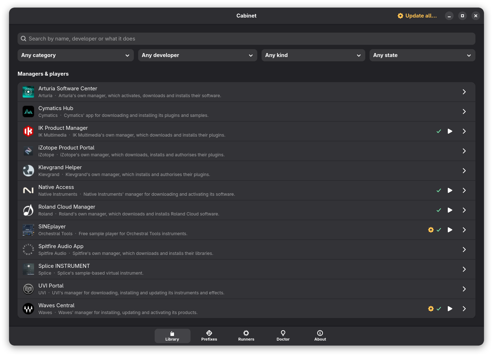

# Cabinet

Cabinet is a Flatpak application that makes it easy to install and use Windows VST plugins in Linux DAWs, without
manually configuring Wine or yabridge. **ARA plugins such as Melodyne work too**, in DAWs that support ARA. Designed
with immutable Linux systems like Fedora Silverblue in mind.

## Goals

- **Ease of use:** Install and use plugins without manually configuring Wine, yabridge, or compatibility settings.
- **Reliability:** Keep vendors in isolated Wine environments, use compatible runners, and detect regressions through
  automated plugin testing.



## Supported vendors

<table>
<tr><th>Managers &amp; players</th><th>Synths</th><th>Effects</th><th>Guitar &amp; bass</th><th>Samplers, drums &amp; keys</th></tr>
<tr valign="top">
<td>Arturia Software Center<br>Cymatics Hub<br>IK Product Manager<br>inMusic Software Center<br>iZotope Product Portal<br>Klevgrand Helper<br>Mastering the Mix Installer Manager<br>Minimal Audio Hub<br>Native Access<br>Plugin Alliance Installation Manager<br>Roland Cloud Manager<br>SINEplayer<br>Spitfire Audio App<br>Splice INSTRUMENT<br>UVI Portal<br>Waves Central</td>
<td>Digital Suburban (Dexed)<br>Madrona Labs<br>Surge Synth Team (Surge XT)<br>u-he<br>Vital Audio<br>Xfer Records (Serum)</td>
<td>Auburn Sounds<br>Audiority (GrainSpace)<br>Baby Audio (Humanoid)<br>Celemony (Melodyne)<br>FabFilter<br>LANDR (Mastering Pro)<br>sonible<br>Sound Radix<br>Soundtoys<br>TAL Software<br>TBProAudio<br>Valhalla DSP<br>Zynaptiq</td>
<td>Line 6 (Helix Native, Helix Stadium Native)<br>Neural Amp Modeler<br>Neural DSP</td>
<td>Decent Samples<br>Decomposer (Sitala)<br>DrumGizmo<br>Manda Audio (MT Power Drum Kit)<br>Modartt (Pianoteq)<br>Novation (Play)<br>Sonic Academy (KICK 3)</td>
</tr>
</table>

## Install

```sh
flatpak remote-add --if-not-exists cabinet \
  https://mark12870.github.io/cabinet/io.github.mark12870.cabinet.flatpakrepo
flatpak install cabinet io.github.mark12870.cabinet
```

**A DAW installed outside Flatpak needs nothing more.** Windows plugins land in `~/.vst3/cabinet/windows`, native ones
in `cabinet/native` (LV2 straight in `~/.lv2`), and the same under `~/.clap` and `~/.vst`, which such a DAW scans.

**A Flatpak DAW has to be enrolled first, once.** Its sandbox hides Cabinet's yabridge, your prefixes and the Wine that
runs them, so without this it sees no Windows plugins at all. Look up its id with `flatpak list --app`, then:

```sh
flatpak run io.github.mark12870.cabinet enrol fm.reaper.Reaper
```

or, in the window, *Doctor → Enrol a DAW*. It changes nothing: it **prints** a `flatpak override` for you to run (see
[Permissions](#permissions)) and a self-test for the DAW's runtime. Restart the DAW afterwards; if an update needs more
permissions, `sync`, the window and `doctor` say so, and `enrol` prints the new command.

Everything is in the window. For the command line, `flatpak run io.github.mark12870.cabinet --help` lists every command.

The Library installs without showing vendors' licences, so installing accepts their terms on your behalf; the window and
`library install` say whose before anything runs.

## Yabridge patches

- **teardown-guard** (Splice crash on removal) — a plugin crashing while removed no longer takes the DAW down.
- **foreign-drag-drop** (WebView2 editors) — stops a Wine drag-and-drop bug crashing them when they open or close.
- **editor-window-origin** (VST2 editors) — keeps the editor in its window, so it shows and clicks land right.
- **chainloader-cabinet-first** (DAWs outside Flatpak) — loads Cabinet's own yabridge before any other installed.
- **state-per-interface** (Kontakt 8 fix) — projects saved on Windows reopen with their instrument instead of empty.
- **short-socket-names** (long plugin names) — a plugin with a long name loads instead of freezing the DAW.
- **ara-unique-buffers** (ARA) — two projects or plugins using ARA at once no longer share one audio buffer.
- **ara-full-reads** (ARA analysis) — ARA plugins such as Auto-Align Post 2 analyse each clip to its end.

## Permissions

`enrol` prints the `flatpak override` rather than applying it, because the DAW then loads native plugins from
`~/.vst*`, `~/.clap` and `~/.lv2`, which the Windows code Cabinet runs can write to, unlike any other Flatpak app's
data. `--talk-name=io.github.mark12870.cabinet.Bridge` lets the shim start Cabinet's Wine, in Cabinet's sandbox, from
inside the DAW's. DAWs enrolled by earlier releases hold `--talk-name=org.freedesktop.Flatpak` instead, which still
works **but lets that DAW run any command on your host**; `doctor` names them.
`flatpak override --user --reset <daw-id>` undoes either. A plugin's own file picker sees only Cabinet's sandbox; to
load a licence file from Downloads, grant `xdg-download:ro` to Cabinet in Flatseal. `flatpak uninstall --delete-data`
**will** delete your prefixes; after it, remove `~/.vst*/cabinet`, `~/.clap/cabinet` and Cabinet's plugins in `~/.lv2`
yourself.

## Building

```sh
flatpak run org.flatpak.Builder --repo=repo --force-clean --default-branch=stable build flatpak/io.github.mark12870.cabinet.yml
flatpak remote-add --user --if-not-exists --no-gpg-verify cabinet-local "file://$PWD/repo"
flatpak install --user --or-update cabinet-local io.github.mark12870.cabinet
```

## Built on

Cabinet builds on these open-source projects:

- **[Wine](https://www.winehq.org/)** — Runs Windows installers, applications, and plugins on Linux.
- **[yabridge](https://github.com/robbert-vdh/yabridge)** — Bridges Windows VST2, VST3, and CLAP plugins into Linux
  DAWs. Cabinet builds it from the [ARA support branch](https://github.com/robbert-vdh/yabridge/pull/500), with
  additional [compatibility patches](PATCHES.md).

## License

GPL-3.0-or-later, matching yabridge. See [LICENSE](LICENSE). The app icon combines the *dresser* and *piano-keys* icons
from [Phosphor Icons](https://phosphoricons.com), recoloured — MIT,
see [flatpak/LICENSE.phosphor](flatpak/LICENSE.phosphor).
